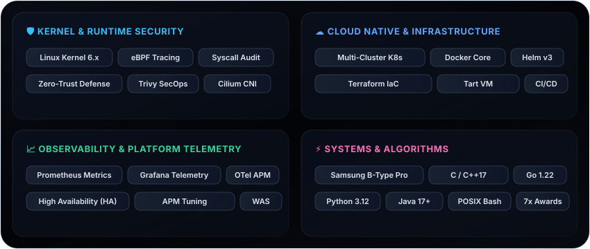

<!--  Hero Banner (Toss Ambient Blue x Apple Space Black Titanium) -->

  

<!-- Identity & Quick Connect (Toss TDS Pure Minimalist Links · 100% Anonymized) -->

  
  &nbsp;&nbsp;
  

 

<!-- Apple HIG & Toss Architectural Philosophy -->

 

###  Flagship Production & Research Showcases

<!-- Bento Grid: 6 Pinned Repositories -->

  
  

  
  

  
  

 

###  Technical Arsenal (Bento Architecture)

  

 

###  Telemetry & System Activity

  
  

  

 

<!-- Apple & Toss Minimalist Footer -->

