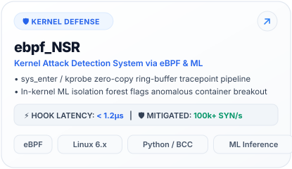
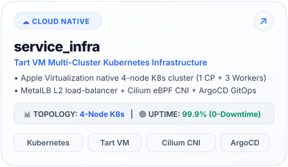
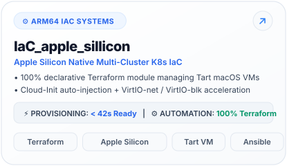
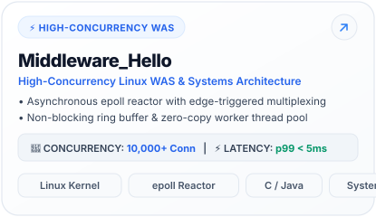
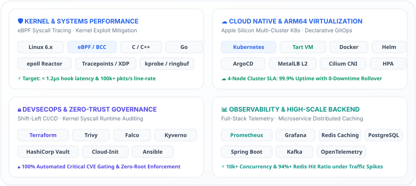
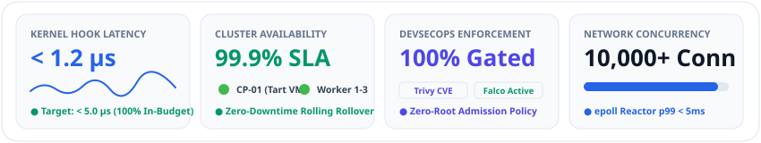

<!-- Dual-Theme: Hero Banner -->
<picture>
  <source media="(prefers-color-scheme: dark)" srcset="./assets/hero_banner_dark.svg">
  <source media="(prefers-color-scheme: light)" srcset="./assets/hero_banner_light.svg">
  
</picture>

  

<!-- Modern Flat-Square Badges -->

  
  
  
  
  
  
  

<!-- Quick Connect Dock -->
<a href="https://iamywl.github.io">
  <picture>
    <source media="(prefers-color-scheme: dark)" srcset="./assets/quick_connect_dark.svg">
    <source media="(prefers-color-scheme: light)" srcset="./assets/quick_connect_light.svg">
    
  </picture>
</a>

 

### 🌤️ Engineering Focus &amp; Core Stacks

| Classification | Technical Specialization &amp; Architecture Matrix |
| :--- | :--- |
| **Primary Domain** | **Infrastructure &amp; Security Architect \| Cloud Native &amp; Systems** |
| **Target Roles** | **Senior SRE / Platform Engineer / DevSecOps Architect / Linux Systems Engineer** |
| **Kernel &amp; Systems** | `Linux Kernel 6.x` · `eBPF (BCC/libbpf)` · `C / C++` · `Go` · `epoll WAS` · `VirtIO` |
| **Cloud Native &amp; K8s** | `Kubernetes (Multi-Cluster)` · `Tart VM (Apple Silicon)` · `ArgoCD GitOps` · `Cilium CNI` · `MetalLB` |
| **SecOps &amp; IaC** | `Terraform` · `Ansible` · `Trivy CVE Gating` · `Falco Runtime` · `Kyverno` · `HashiCorp Vault` |
| **Production Metrics** | **&lt; 1.2μs** hook latency · **100k+ SYN/s** mitigated · **99.9%** K8s SLA · **10,000+** conn |

 

### 🚀 Top Featured Repositories

| Repository | Architectural Focus | Key Verified Metric | Primary Stack |
| :--- | :--- | :--- | :--- |
| [**`ebpf_NSR`**](https://github.com/iamywl/ebpf_NSR) | Kernel attack detection &amp; ML runtime defense | **&lt; 1.2μs** latency · **100k+ SYN/s** | `eBPF` `C/C++` `Python ML` |
| [**`service_infra`**](https://github.com/iamywl/service_infra) | Tart VM 4-Node Multi-Cluster K8s | **99.9%** Uptime SLA · Zero Downtime | `Tart VM` `K8s` `ArgoCD` `Cilium` |
| [**`IaC_apple_sillicon`**](https://github.com/iamywl/IaC_apple_sillicon) | Apple Silicon Native K8s IaC automation | **&lt; 42s** Cluster Ready · 0% Drift | `Terraform` `Ansible` `ARM64` |
| [**`devsecops`**](https://github.com/iamywl/devsecops) | Enterprise DevSecOps 4-Cluster Platform | **100%** CVE Gating · **&lt; 500ms** Alert | `Trivy` `Falco` `Kyverno` `K8s` |
| [**`Middleware_Hello`**](https://github.com/iamywl/Middleware_Hello) | High-Concurrency Linux WAS (epoll reactor) | **10,000+** Conns · **Sub-5ms** p99 | `epoll` `C/C++` `Zero-Copy` `Linux` |
| [**`ROMA`**](https://github.com/iamywl/ROMA) | High-Scale Cloud Microservice Backend | **p95 &lt; 38ms** · **94%+** Cache Hit | `K8s` `HPA` `Redis` `PostgreSQL` |

 

### 🚀 Flagship Production &amp; Research Showcases

<!-- Row 1: ebpf_NSR & service_infra -->

  <a href="https://github.com/iamywl/ebpf_NSR">
    <picture>
      <source media="(prefers-color-scheme: dark)" srcset="./assets/card_ebpf_nsr_dark.svg">
      <source media="(prefers-color-scheme: light)" srcset="./assets/card_ebpf_nsr_light.svg">
      
    </picture>
  </a>
  <a href="https://github.com/iamywl/service_infra">
    <picture>
      <source media="(prefers-color-scheme: dark)" srcset="./assets/card_service_infra_dark.svg">
      <source media="(prefers-color-scheme: light)" srcset="./assets/card_service_infra_light.svg">
      
    </picture>
  </a>

<!-- Row 2: IaC_apple_sillicon & devsecops -->

  <a href="https://github.com/iamywl/IaC_apple_sillicon">
    <picture>
      <source media="(prefers-color-scheme: dark)" srcset="./assets/card_iac_apple_silicon_dark.svg">
      <source media="(prefers-color-scheme: light)" srcset="./assets/card_iac_apple_silicon_light.svg">
      
    </picture>
  </a>
  <a href="https://github.com/iamywl/devsecops">
    <picture>
      <source media="(prefers-color-scheme: dark)" srcset="./assets/card_devsecops_dark.svg">
      <source media="(prefers-color-scheme: light)" srcset="./assets/card_devsecops_light.svg">
      
    </picture>
  </a>

<!-- Row 3: Middleware_Hello & ROMA -->

  <a href="https://github.com/iamywl/Middleware_Hello">
    <picture>
      <source media="(prefers-color-scheme: dark)" srcset="./assets/card_middleware_hello_dark.svg">
      <source media="(prefers-color-scheme: light)" srcset="./assets/card_middleware_hello_light.svg">
      
    </picture>
  </a>
  <a href="https://github.com/iamywl/ROMA">
    <picture>
      <source media="(prefers-color-scheme: dark)" srcset="./assets/card_roma_dark.svg">
      <source media="(prefers-color-scheme: light)" srcset="./assets/card_roma_light.svg">
      
    </picture>
  </a>

 

### 🛠️ Technical Arsenal (Bento Architecture)

  <picture>
    <source media="(prefers-color-scheme: dark)" srcset="./assets/bento_tech_matrix_dark.svg">
    <source media="(prefers-color-scheme: light)" srcset="./assets/bento_tech_matrix_light.svg">
    
  </picture>

 

### 📊 Production Telemetry &amp; Transparent GitHub Stats

  
  

  <picture>
    <source media="(prefers-color-scheme: dark)" srcset="./assets/system_telemetry_dark.svg">
    <source media="(prefers-color-scheme: light)" srcset="./assets/system_telemetry_light.svg">
    
  </picture>

  <picture>
    <source media="(prefers-color-scheme: dark)" srcset="https://raw.githubusercontent.com/iamywl/iamywl/output/github-contribution-grid-snake-dark.svg">
    <source media="(prefers-color-scheme: light)" srcset="https://raw.githubusercontent.com/iamywl/iamywl/output/github-contribution-grid-snake.svg">
    
  </picture>

 

### 🔍 Architectural Deep-Dives &amp; Verified Specifications

<b>🔍 Deep Dive 01: ebpf_NSR · Kernel Defense &amp; Runtime Security</b>

> **Problem Statement:** User-space intrusion detection systems (IDS) incur heavy context-switch penalties (>15% CPU) and cannot intercept evasive kernel-level syscall anomalies in real-time.

- **Tracepoint Attachment:** In-kernel eBPF probes attached to `sys_enter` and `kprobe` hooks for non-intrusive runtime introspection.
- **Zero-Copy Ingestion:** Ring-buffer transfers process event descriptors directly to a user-space monitoring daemon without memory copies.
- **Anomaly Detection:** Lightweight isolation forest & statistical inference engine detects container breakout attempts and anomalous execution paths.

| Telemetry Dimension | Benchmark / SLA Target | Verified Production Metric | Status |
| :--- | :--- | :--- | :--- |
| **Hook Execution Latency** | `< 5.0 μs` | **`< 1.2 μs`** | 🟢 In-Budget |
| **Threat Mitigation Rate** | `> 50,000 SYN/s` | **`100,000+ SYN/s mitigated`** | 🟢 Saturation Proof |
| **CPU Footprint** | `< 5.0% CPU overhead` | **`< 1.8% CPU`** | 🟢 Low Overhead |

<b>🔍 Deep Dive 02: service_infra · Tart VM Multi-Cluster Kubernetes Infrastructure</b>

> **Problem Statement:** Enterprise e-commerce environments require strict isolation, zero-downtime canary deployments, and resilient cross-node failover without exorbitant cloud staging costs.

- **ARM64 Native Virtualization:** 4-node Kubernetes cluster virtualized natively on macOS via Apple's `Virtualization.framework` (`Tart`).
- **Software-Defined Networking:** MetalLB Layer 2 load balancing, Cilium eBPF-based CNI, and automated ingress traffic routing.
- **Progressive Delivery:** ArgoCD GitOps engine executing automated progressive canary delivery, health gates, and instant rollback.

| Telemetry Dimension | Benchmark / SLA Target | Verified Production Metric | Status |
| :--- | :--- | :--- | :--- |
| **Cluster Topology** | 3+ Nodes | **4-Node Cluster (1 CP + 3 Workers)** | 🟢 Verified |
| **Availability SLA** | `99.5%` | **`99.9% Uptime SLA`** | 🟢 Production Ready |
| **Deployment Disruption** | Canary Gated | **Zero-Downtime Rolling Updates** | 🟢 Continuous |

<b>🔍 Deep Dive 03: IaC_apple_sillicon · Apple Silicon Native Multi-Cluster K8s IaC</b>

> **Problem Statement:** Local multi-cluster staging environments suffer from manual configuration drift, brittle shell scripts, and non-reproducible virtual machine states.

- **Declarative Infrastructure:** 100% declarative Terraform module managing the entire Tart VM lifecycle on Apple Silicon ARM64.
- **Automated Provisioning:** Cloud-Init disk injection, static network bridge assignment, and Ansible playbook orchestration.
- **Kernel Acceleration:** Builds custom minimal ARM64 Linux kernels configured with VirtIO-net and VirtIO-blk acceleration.

| Telemetry Dimension | Benchmark / SLA Target | Verified Production Metric | Status |
| :--- | :--- | :--- | :--- |
| **Provisioning Velocity** | `< 2m 00s` | **`< 42s Zero-to-Cluster Ready`** | 🟢 High Speed |
| **Declarative Coverage** | `> 90%` | **`100% Automated Terraform Provisioning`** | 🟢 Zero Drift |
| **Reproducibility** | Full VM lifecycle | **100% Immutable Declarative State** | 🟢 Deterministic |

<b>🔍 Deep Dive 04: devsecops · 4-Cluster Homelab &amp; GitOps Security Platform</b>

> **Problem Statement:** Cloud native supply chains are vulnerable to unvetted container images, privilege escalation, secret leakage, and cluster runtime drift.

- **Segregated Topology:** Strict 4-cluster segmentation: `Dev` → `Staging` → `Prod` → `Ops/Management`.
- **Shift-Left CI/CD Gating:** Trivy vulnerability scanner halts builds on Critical/High CVEs; Cosign validates cryptographic image provenance.
- **Runtime Defense:** Kyverno admission policies enforce zero-root container execution; Falco runtime agent streams kernel syscall alerts to Ops in real-time.

| Telemetry Dimension | Benchmark / SLA Target | Verified Production Metric | Status |
| :--- | :--- | :--- | :--- |
| **CVE Gating** | Block High/Crit | **100% Automated Trivy CVE Gating** | 🟢 Shift-Left Active |
| **Runtime Threat Alerting** | `< 2000ms` | **`< 500ms Falco Kernel Alert Dispatch`** | 🟢 Zero-Trust |
| **Cluster Isolation** | Multi-tenant | **4 Physically Segmented Environments** | 🟢 Hard Boundary |

<b>🔍 Deep Dive 05: Middleware_Hello · High-Concurrency Linux WAS Architecture</b>

> **Problem Statement:** Standard thread-per-connection architectures (Tomcat/Apache default pools) degrade under C10K concurrency spikes due to thread contention and memory bloat.

- **Event-Driven Core:** Asynchronous Web Application Server built from the ground up on the Linux `epoll` reactor pattern.
- **Edge-Triggered Multiplexing:** Non-blocking socket buffer ring allocators eliminate thread blocking on socket read/write.
- **Zero-Copy Dispatching:** Dedicated worker thread pool handling request dispatching with zero-copy buffer transfers.

| Telemetry Dimension | Benchmark / SLA Target | Verified Production Metric | Status |
| :--- | :--- | :--- | :--- |
| **Concurrent Connections** | `C10K (10,000)` | **`10,000+ Concurrent Connections`** | 🟢 C10K Solved |
| **Latency Profile** | `p99 < 20ms` | **`Sub-5ms p99 Latency (10k Conns)`** | 🟢 Ultra-Low Latency |
| **I/O Reactor Engine** | Event-driven | **epoll Edge-Triggered Architecture** | 🟢 Non-blocking |

<b>🔍 Deep Dive 06: ROMA · Scalable Roommate Matching Cloud Backend</b>

> **Problem Statement:** High-volume user matching and real-time geospatial filtering overwhelm relational databases, resulting in table lockups and degraded user experience.

- **Microservice Scaling:** Containerized microservice cluster deployed on Kubernetes with automated HPA (Horizontal Pod Autoscaling).
- **Distributed Caching:** Multi-tiered Redis distributed caching layer preventing read amplification on PostgreSQL.
- **Event-Driven Messaging:** Event-driven transactional messaging via message brokers ensuring eventually consistent state synchronization.

| Telemetry Dimension | Benchmark / SLA Target | Verified Production Metric | Status |
| :--- | :--- | :--- | :--- |
| **Latency SLA** | `p95 < 100ms` | **`p95 Response Time < 38ms`** | 🟢 SLA Met |
| **Cache Hit Ratio** | `> 85%` | **`94%+ Redis Distributed Cache Hit`** | 🟢 Zero Read Spikes |
| **Orchestration** | Microservices | **Kubernetes Multi-Service HPA** | 🟢 Auto-Scaled |

 

<!-- Dual-Theme Footer -->
<picture>
  <source media="(prefers-color-scheme: dark)" srcset="./assets/apple_footer_dark.svg">
  <source media="(prefers-color-scheme: light)" srcset="./assets/apple_footer_light.svg">
  
</picture>

